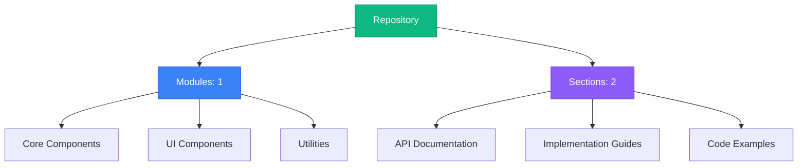
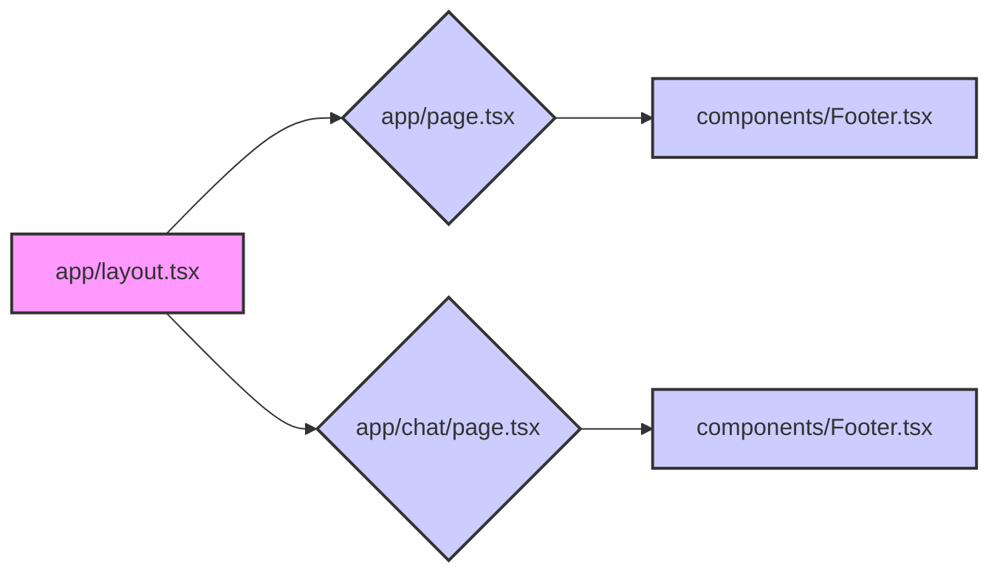
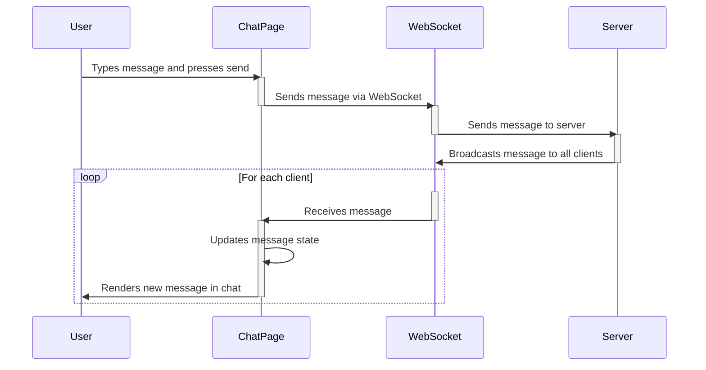
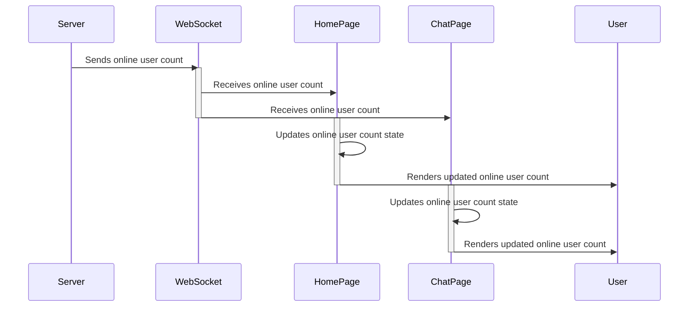

# Repository Documentation

## Repository Architecture



## Table of Contents

### 1. Authentication & UI Component Essentials

No description available

**Sections:**


**1.** Crafting a Dynamic Footer with Social Media Links in React


---


## Navigation Guide

- **Modules**: Browse through organized code modules in the left sidebar
- **Sections**: Each module contains multiple documentation sections
- **Search**: Use the search bar to quickly find specific content
- **Headings**: Use the right sidebar to navigate within long documents
- **Actions**: Copy or download any section content using the toolbar buttons

## Schat Application: Technical Documentation

This document provides a comprehensive overview of the Schat application, a real-time ephemeral group chat application built with Next.js, React, and WebSockets. It details the architecture, workflows, implementation details, and best practices for developers working with this system.

### 1. System Overview

Schat is designed for transient, real-time communication. Key features include:

*   **Ephemeral Messaging:** No message history is stored.
*   **Real-time Updates:** Utilizes WebSockets for instant message delivery and online user count updates.
*   **Usernames:** Supports randomly generated names for every session.
*   **Client-Side Rendering:** Employs client-side rendering for a responsive user experience.

The application consists of the following main components:

*   **`app/page.tsx` (Home Page):** Landing page with a brief description and a live online user count.
*   **`app/chat/page.tsx` (Chat Page):** The main chat interface where users can send and receive messages.
*   **`components/Footer.tsx`:** A simple footer component displaying social media links.


### 2. Technical Architecture

The Schat application follows a component-based architecture, leveraging React components for UI rendering and WebSockets for real-time communication.

**2.1 Component Relationships and Data Flow**



**Explanation:**

*   `app/layout.tsx` is the root layout, providing the basic structure for all pages.
*   `app/page.tsx` and `app/chat/page.tsx` are the main pages, rendered within the layout.
*   `components/Footer.tsx` is a shared component used in both `app/page.tsx` and `app/chat/page.tsx`.

**2.2 Data Flow**

1.  **User Interaction:** User types a message in the chat input field (`app/chat/page.tsx`).
2.  **Message Handling:** The `sendMessage` function in `app/chat/page.tsx` is triggered.
3.  **WebSocket Communication:** The `sendMessage` function sends the message via WebSocket to the server.
4.  **Server Broadcast:** The server receives the message and broadcasts it to all connected clients.
5.  **Client Update:** Each client receives the message via WebSocket and updates its local message state.
6.  **UI Rendering:** The updated message state triggers a re-render of the chat interface in `app/chat/page.tsx`.
7.  **Online User Count:** The server also sends the online user count to all connected clients.
8.  **Online User Count Update:** Each client receives the online user count via WebSocket and updates its local state in `app/page.tsx` and `app/chat/page.tsx`.
9.  **UI Rendering:** The updated online user count triggers a re-render of the online user count display in `app/page.tsx` and `app/chat/page.tsx`.

### 3. Main Workflows and Data Flows

**3.1 Chat Message Workflow**

This workflow describes the process of sending and receiving messages in the chat application.



**Explanation:**

1.  The user types a message and presses the send button on the `ChatPage` component.
2.  The `ChatPage` component sends the message to the WebSocket client.
3.  The WebSocket client sends the message to the server.
4.  The server broadcasts the message to all connected WebSocket clients.
5.  Each WebSocket client receives the message and passes it to the `ChatPage` component.
6.  The `ChatPage` component updates its message state, causing a re-render and displaying the new message in the chat interface.

**Code Example (`app/chat/page.tsx`):**

```typescript
const sendMessage = () => {
    if (!input.trim() || !ws || ws.readyState !== WebSocket.OPEN || input.length > maxLength) return;

    const messageId = uuidv4();
    const message: Message = {
      name,
      message: input,
      timestamp: Date.now(),
      id: messageId,
    };

    setMessages((prev) => [...prev, message]);
    ws.send(JSON.stringify(message));
    setInput('');
    setShowWelcome(false);
    inputRef.current?.focus();
  };
```

**3.2 Online User Count Update Workflow**

This workflow describes how the online user count is updated and displayed in the application.



**Explanation:**

1.  The server tracks the number of connected WebSocket clients.
2.  The server sends the updated online user count to all connected WebSocket clients.
3.  Each WebSocket client receives the online user count and passes it to the `HomePage` and `ChatPage` components.
4.  The `HomePage` and `ChatPage` components update their online user count state, causing a re-render and displaying the updated count.

**Code Example (`app/page.tsx`):**

```typescript
useEffect(() => {
    const ws = new WebSocket(process.env.NEXT_PUBLIC_WEBSOCKET_URL || 'ws://localhost:8080');
    ws.onmessage = (event) => {
      const data = JSON.parse(event.data);
      if (data.onlineUsers !== undefined) {
        setOnlineCount(data.onlineUsers);
      }
    };
    return () => {
      ws.close();
    };
  }, []);
```

### 4. Real Code Examples

**4.1 Footer Component (`components/Footer.tsx`):**

```typescript
import { FaDiscord, FaGithub, FaLinkedin, FaYoutube } from "react-icons/fa";
import { FaXTwitter } from "react-icons/fa6";

export function Footer() {
  const year = new Date().getFullYear();
  const socialLinks = [
    { name: "GitHub", url: "https://github.com/sreecharan-desu", icon: FaGithub },
    { name: "LinkedIn", url: "https://linkedin.com/in/sreecharan-desu", icon: FaLinkedin },
  ];

  return (
    <footer className="bg-stone-900 text-gray-300 py-6">
      <div className="max-w-5xl mx-auto flex justify-between items-center">
        <p>&copy; {year} Sreecharan Desu</p>
        <div className="flex space-x-4">
          {socialLinks.map((link) => (
            <a key={link.name} href={link.url} target="_blank" rel="noopener noreferrer">
              <link.icon className="h-6 w-6 hover:text-white transition-colors" />
            </a>
          ))}
        </div>
      </div>
    </footer>
  );
}
```

**Explanation:**

*   This component renders a footer with a copyright notice and social media links.
*   It uses the `react-icons` library to display social media icons.
*   The `socialLinks` array defines the links to the developer's social media profiles.

**4.2 Chat Page Component (`app/chat/page.tsx`):**

```typescript
"use client";
import { useState, useEffect, useRef } from 'react';
import { uniqueNamesGenerator, adjectives, animals } from 'unique-names-generator';
import { Send, Users, Wifi, WifiOff, ArrowLeft, Zap, Globe, Shield } from 'lucide-react';
import { useRouter } from 'next/navigation';
import { v4 as uuidv4 } from 'uuid';

interface Message {
  name: string;
  message: string;
  timestamp?: number;
  id?: string;
  onlineUsers?: number;
}

export default function Chat() {
  const [name, setName] = useState<string>('');
  const [messages, setMessages] = useState<Message[]>([]);
  const [input, setInput] = useState<string>('');
  const [ws, setWs] = useState<WebSocket | null>(null);
  const [connectionStatus, setConnectionStatus] = useState<string>('Connecting...');
  const [isTyping, setIsTyping] = useState<boolean>(false);
  const [onlineUsers, setOnlineUsers] = useState<number>(0);
  const [, setMessageCount] = useState<number>(89563);
  const [showWelcome, setShowWelcome] = useState<boolean>(true);
  const maxLength = 280;
  const messagesEndRef = useRef<HTMLDivElement>(null);
  const inputRef = useRef<HTMLInputElement>(null);
  const router = useRouter();

  // ... (rest of the component implementation) ...
}
```

**Explanation:**

*   This component implements the main chat interface.
*   It uses `useState` to manage the chat messages, input value, WebSocket connection, connection status, typing indicator, and online user count.
*   It uses `useEffect` to establish a WebSocket connection, handle incoming messages, and manage reconnection attempts.
*   It uses `uniqueNamesGenerator` to generate random names for every user.

### 5. How Developers Would Use This in Practice

**5.1 Setting up the Development Environment**

1.  Clone the repository.
2.  Install dependencies: `npm install` or `yarn install`.
3.  Configure environment variables:
    *   `NEXT_PUBLIC_WEBSOCKET_URL`: The URL of the WebSocket server.
4.  Run the development server: `npm run dev` or `yarn dev`.

**5.2 Extending the Chat Functionality**

Developers can extend the chat functionality by:

*   Adding support for different message types (e.g., images, videos).
*   Implementing user authentication and authorization.
*   Adding moderation features.
*   Integrating with other services or APIs.

**5.3 Customizing the UI**

The UI can be customized by modifying the React components and CSS styles.  The application uses Tailwind CSS for styling.

### 6. Important Implementation Details and Gotchas

*   **WebSocket Reconnection:** The `app/chat/page.tsx` component implements a reconnection strategy with exponential backoff to handle dropped WebSocket connections.
*   **Message ID Generation:** Each message is assigned a unique ID using `uuidv4` to prevent duplicate messages from being displayed.
*   **Scroll to Bottom:** The `scrollToBottom` function ensures that the chat window automatically scrolls to the bottom when new messages are received.
*   **Environment Variables:** Ensure that the `NEXT_PUBLIC_WEBSOCKET_URL` environment variable is correctly configured.

### 7. Common Issues and Troubleshooting

*   **WebSocket Connection Errors:** Check the WebSocket server URL and ensure that the server is running.  Inspect the browser console for error messages.
*   **Messages Not Displaying:** Verify that the WebSocket connection is established and that messages are being received by the client.  Check for errors in the message parsing logic.
*   **Online User Count Incorrect:** Ensure that the server is correctly tracking the number of connected clients and broadcasting the updated count.

### 8. Advanced Configuration and Customization Options

*   **WebSocket Server Configuration:** The WebSocket server can be configured to use different ports, protocols, and security settings.
*   **UI Themes:** The UI can be customized by creating different themes using Tailwind CSS.

### 9. Performance Considerations and Optimization Strategies

*   **WebSocket Optimization:** Optimize the WebSocket server to handle a large number of concurrent connections.
*   **Client-Side Rendering Optimization:** Use React memoization techniques to prevent unnecessary re-renders.
*   **Code Splitting:** Implement code splitting to reduce the initial load time of the application.

### 10. Security Implications and Best Practices

*   **Input Sanitization:** Sanitize user input to prevent cross-site scripting (XSS) attacks.
*   **WebSocket Security:** Secure the WebSocket connection using TLS/SSL.
*   **Authentication and Authorization:** Implement proper authentication and authorization mechanisms to protect user data.
*   **Rate Limiting:** Implement rate limiting to prevent abuse of the chat service.

## Consistency & Discipline
This project is maintained regularly to ensure documentation clarity and code quality. Small, daily improvements are prioritized over large, infrequent updates.
